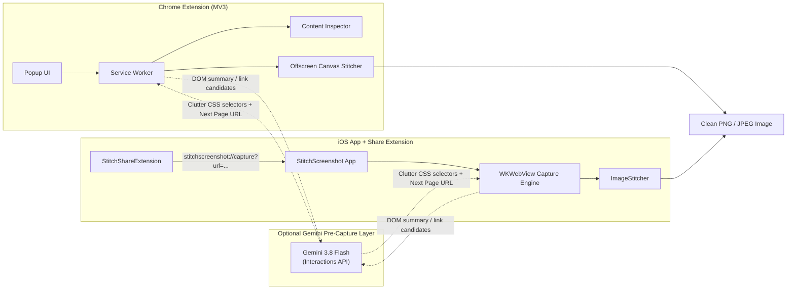

# PageStitch — Cross-Platform Full-Page & Multi-Page Screenshot Stitcher

**PageStitch** captures full scrolling web pages and multi-page paginated articles into a **single, clean PNG or JPEG image**—across desktop (**Manifest V3 Chrome Extension**) and iPhone (**SwiftUI iOS App + Share Extension**).

By design, **the final output is strictly an image (`PNG` or `JPEG`)**—no text summaries, AI captions, or secondary text exports. Optional **Gemini (`gemini-3.8-flash`)** integration runs solely *before* capture to improve image cleanliness and multi-page continuity.

---

## Architecture Overview



### How Gemini Improves Image Capture (Optional)
Both clients work deterministically offline using native browser/iOS rendering and heuristic cleanup. When you supply a Gemini API key in Settings, both clients call `gemini-3.8-flash` via the Gemini **Interactions API** (`POST https://generativelanguage.googleapis.com/v1beta/interactions` with `Api-Revision: 2026-05-20` and structured `response_format`) for two focused pre-capture tasks:

1. **Pre-Capture Decluttering (`detectClutterSelectors` / `detectClutterSelectors(for:)`):** Inspects a compact DOM summary of `position: fixed` / `sticky` elements, overlays, cookie banners, modals, and ad wrappers, returning safe CSS selectors to temporarily hide before capturing (restored immediately afterward). Discovered selectors are cached per domain (`chrome.storage.local` on Chrome; `UserDefaults` via `DomainSelectorCache` on iOS).
2. **Smart Pagination Detection (`detectNextPageUrl` / `detectNextPageURL(for:)`):** Evaluates candidate links (`<a>` / `<link rel="next">`) on paginated articles to locate the true continuation URL without accidentally following "Related" or "Next Article" links.

> **Pixel Fidelity:** Actual page pixels are always rendered natively by Chromium (`chrome.tabs.captureVisibleTab` + Offscreen Canvas) and WebKit (`WKWebView.takeSnapshot(with:)` + CoreGraphics). Gemini never alters or regenerates page text or pixels.

---

## Repository Layout

```text
.
├── AGENTS.md
├── LICENSE
├── README.md
├── chrome-extension/
│   ├── manifest.json                   # Manifest V3 config
│   ├── package.json                    # Node test runner script
│   ├── background/
│   │   └── service-worker.js           # Stateless MV3 capture & download coordinator
│   ├── content/
│   │   └── page-inspector.js           # rAF-batched DOM inspection, scroll & fixed-bar hiding
│   ├── offscreen/
│   │   ├── offscreen.html
│   │   └── offscreen.js                # Canvas viewport & multi-page vertical stitcher
│   ├── popup/
│   │   ├── popup.html                  # Semantic, accessible popup UI
│   │   ├── popup.css
│   │   └── popup.js
│   ├── shared/
│   │   ├── gemini-client.js            # Gemini 3.8 Flash Interactions API + domain TTL cache
│   │   └── stitch-math.js              # Pure scroll offset, DPR crop, scale & link scoring helpers
│   ├── scripts/
│   │   └── generate-icons.mjs          # Generates 16x16, 48x48, 128x128 RGBA PNG icons
│   ├── icons/
│   │   ├── icon-16.png
│   │   ├── icon-48.png
│   │   └── icon-128.png
│   └── tests/
│       └── extension.test.js           # 13 unit & MV3/CSP compliance tests
└── ios-app/
    └── StitchScreenshot/
        ├── StitchScreenshot.xcodeproj/
        ├── StitchScreenshot/
        │   ├── StitchScreenshotApp.swift   # App entry + deep-link URL handler
        │   ├── ContentView.swift           # In-app WKWebView browser, staged tray & capture bar
        │   ├── Info.plist                  # CFBundleURLTypes + NSPhotoLibraryAddUsageDescription
        │   ├── Models/
        │   │   └── CaptureModels.swift     # Format, StagedPage, DeepLinkParser, AppSettingsStore
        │   ├── Services/
        │   │   ├── GeminiService.swift     # Gemini 3.8 Flash Interactions API + DomainSelectorCache
        │   │   ├── ImageStitcher.swift     # CoreGraphics vertical stitcher, overlap crop & encoder
        │   │   ├── KeychainService.swift   # Secure Keychain storage for Gemini API key
        │   │   ├── PhotoLibraryService.swift
        │   │   └── WebCaptureService.swift # WKWebView snapshot capture, clutter hiding & auto-stitch
        │   └── Views/
        │       ├── PreviewSheet.swift      # Zoomable image preview, Photos save, Copy & Share Sheet
        │       ├── SettingsView.swift      # Keychain API key & capture settings
        │       └── WebViewContainer.swift
        ├── StitchShareExtension/
        │   ├── Info.plist                  # Web URL & text share activation rules
        │   └── ShareViewController.swift   # Extracts shared URL and opens host app
        ├── StitchScreenshotTests/
        │   └── StitchScreenshotTests.swift # 14 Swift unit tests
        └── StitchScreenshotUITests/
            └── StitchScreenshotUITests.swift
```

---

## 1. Chrome Extension (`chrome-extension/`)

### Capabilities
- **Capture Full Page:** Scrolls through the active tab (`560ms` pacing to respect Chrome's `captureVisibleTab` quota), suppresses sticky/fixed bars after the first viewport slice, crops bottom overlap at device pixel ratio, and stitches viewports inside an offscreen document (`chrome.offscreen`).
- **Append & Stitch (Manual Multi-Page):** Stage captures across multiple pages in `chrome.storage.local`, navigate manually, and stitch all staged pages into one vertical image.
- **Auto-Capture Multi-Page:** Walks paginated articles up to a configurable page limit (`2–15` pages) using Gemini or `rel="next"`/pagination heuristics, preventing duplicate URL loops.
- **Pre-Capture Cleanup:** Temporarily injects `<style data-stitch-cleanup>` for heuristic cookie/chat/overlay selectors plus cached Gemini domain selectors, always restoring the page in `try/finally`.
- **Image-Only Export:** Preview thumbnail in popup, **Copy Image** (`ClipboardItem` PNG), or **Download Image** (`chrome.downloads.download` in PNG or JPEG).
- **Canvas Safety:** `computeSafeCanvasScale` automatically scales oversized dimensions to stay within `16384×16384` / `268M` px browser canvas limits.

### Installation (Developer Mode)
1. Open `chrome://extensions` in Google Chrome.
2. Enable **Developer mode** (top-right toggle).
3. Click **Load unpacked** and select `chrome-extension/`.
4. Click the **PageStitch** toolbar icon on any `http://` or `https://` page.
5. *(Optional)* Expand **Settings**, paste your Gemini API key (stored locally in `chrome.storage.local`), choose PNG or JPEG, and adjust max auto-pages.

### Running Chrome Extension Tests
Requires Node.js (v20+ recommended):

```sh
cd chrome-extension
npm test
```

The test suite (`node --test tests/*.test.js`) verifies:
- Scroll offset calculation, DPR bottom-slice overlap cropping, and safe multi-page downscaling (`stitch-math.js`)
- Pagination candidate scoring and CSS selector sanitization
- Gemini Interactions API headers (`x-goog-api-key`, `Api-Revision`), model (`gemini-3.8-flash`), JSON schema payload, `steps` / `outputs` parsing, and 7-day domain cache TTL (`gemini-client.js`)
- `manifest.json` MV3 validity, real PNG icon IHDR dimensions (`16×16`, `48×48`, `128×128`), zero inline `<script>` / event handlers / `style` attributes in HTML, and `node --check` syntax across all JS files.

---

## 2. iOS App & Share Extension (`ios-app/StitchScreenshot/`)

### Capabilities
- **In-App `WKWebView` Browser:** Address bar, Back/Forward/Reload/Stop controls, quick links, and clipboard URL paste-and-open.
- **Share Extension (`StitchShareExtension`):** Tap **Share** in Safari, Chrome, or other iOS apps to hand off a webpage URL directly to `StitchScreenshot` via `stitchscreenshot://capture?url=<encoded>`.
- **Full-Page & Multi-Page Stitching:**
  - Scroll-and-stitch via `WKWebView.takeSnapshot(with:)` with sticky-element suppression after slice 0 and `cropTopAndBottomOverlap`.
  - Manual **Append** tray with thumbnail reordering and deletion before **Stitch**.
  - **Auto Stitch** for paginated articles using `GeminiService` or `PaginationHeuristic`.
  - `ImageStitcher` aligns mismatched widths proportionally and caps output safely (`3600px` max width, `24000px` max height by default) to stay within iOS memory budgets.
- **Image-Only Export & Sharing:** Zoomable preview in `PreviewSheet`, **PNG / JPEG** format toggle, **Save to Photos** (`PHPhotoLibrary` `.addOnly`), **Copy Image** (`UIPasteboard.general`), and native `UIActivityViewController` Share Sheet sharing only the rendered image.
- **Secure Keychain Storage:** Optional Gemini API key stored via `KeychainService` (`Security` framework) inside **Settings**.

### Running in Xcode
1. Open `ios-app/StitchScreenshot/StitchScreenshot.xcodeproj` in Xcode.
2. Select the **`StitchScreenshot`** scheme and choose an iOS Simulator (e.g., `iPhone 18 Pro`) or physical iOS device (set your Development Team under Signing & Capabilities for device builds).
3. Press **Cmd+R** to launch, or **Cmd+U** to run `StitchScreenshotTests` and `StitchScreenshotUITests`.

### Running iOS Tests from CLI
```sh
xcodebuild test \
  -project ios-app/StitchScreenshot/StitchScreenshot.xcodeproj \
  -scheme StitchScreenshot \
  -destination 'platform=iOS Simulator,name=iPhone 18 Pro'
```

---

## Troubleshooting & Caveats
- **Restricted Chrome pages:** Chrome blocks extensions from capturing `chrome://`, `chrome-extension://`, and Chrome Web Store URLs.
- **Infinite scroll / dynamic SPAs:** Very long infinite-scroll feeds are clamped safely (`60,000px` CSS height on Chrome; `24,000px` output height cap on iOS) to prevent tab or app OOM crashes.
- **Share Extension handoff:** `StitchShareExtension` hands the URL off via `stitchscreenshot://capture?url=...` so no paid Apple Developer App Group entitlement is required to build and run on Simulator.
- **API Key Privacy:** Gemini API keys are stored strictly locally (`chrome.storage.local` in Chrome, iOS Keychain on iPhone) and are never hardcoded or committed to git.
